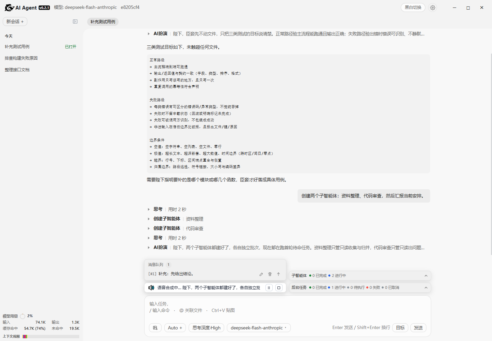

**English** | [中文](README.zh.md)

# AI Agent

<p align="center">
  <strong>An extensible, composable AI Agent foundation</strong>
  <br>
  Runs locally or as a service. Inspectable execution, controlled writes.<br>
  Extend and compose models, tools, plugins, and business integrations.
</p>

<p align="center">
  
  
  
</p>

## Download

Open [Releases](https://github.com/diky87688973/ai-agent/releases), choose a version, and download from **Assets**.

### Windows

- `ai-agent-<version>-full-pack-windows.zip`
  For first-time use. Unzip and run `agent-gui.exe`.

- `ai-agent-<version>-update-pack-windows.zip`
  Only for automatic updates of an installed copy. It cannot run standalone.

### macOS

- `ai-agent-<version>-full-pack-macos.zip`
- `ai-agent-<version>-update-pack-macos.zip`

macOS packages are not built yet. Current releases provide Windows packages only.

## Highlights

- **Local-first, model-endpoint agnostic** — sessions, files, tools, and write gates run on the local machine. Configure model endpoints and reasoning levels as needed.
- **Four entry points, one kernel** — desktop GUI, Web UI, interactive terminal, and headless execution share sessions, tools, and gates. Switching entry points does not change behavior.
- **Service-ready** — the kernel is not tied to a UI. The Web entry provides local HTTP/SSE and health checks. The headless entry targets scripts, CI, tickets, and external systems. Plugins can add their own HTTP endpoints.
- **Access control** — browser login, one-time GUI auto-login, scrypt passwords, HttpOnly sessions, CSRF, scoped tokens, login rate limiting, and TLS for public bindings.
- **Plugin extensions** — tools, executors, context, prompts, gates, model catalogs, HTTP endpoints, and UI assets can be added without changing the kernel. Built-in plugins include Skills, Rules, Knowledge, Multi-model, Visual Operator, and AI Speak.
- **Visual operation** — continuous visual capability; after authorization, operate the system smoothly, with takeover available at any time and a traceable process. (Windows only for now.)
- **Multi-agent collaboration** — subagents are created in batches with independent sessions and role-specific tool views. Parent/child messaging, queues, and work reports are supported.
- **Manageable long-running work** — background tasks are isolated per session with concurrency limits, timeouts, cancellation, and output retrieval. Goals, todos, and message queues support multi-turn progress.
- **Scheduled wakeups** — register relative or absolute wake jobs; the host delivers them after the turn ends and the target is idle or queued.
- **Four-step writes** — preview → review → commit → re-read, so changes are confirmed before they land; automatic backup before edits makes failures and wrong results rollback-safe, and deletions go to the recycle directory.
- **Context management** — segment budgets, over-budget summaries, context usage, and request snapshots. Persisted fact streams and SSE resume by event coordinates.
- **Safe updates** — update-pack hash checks, staging, health checks, and rollback on failure. Regular files are replaced; `*.ini` files merge user settings.

## Plugin architecture

A plugin is the install/enable unit; the plugin tree is the contribution view, and the slot tree (`SlotTree`) is the assembled result. The whole `app` is recursively assembled from the startup tree; it is not a fixed app with an extension point. Kernel, host, tools, and shell are startup slots; plugins replace or add nodes before assembly. `App` is only the facade; `boot_app()` reads the tree, merges overrides, and assembles recursively.

```text
Startup flow (whole app)
App starts
  |
  |-- read agent/boot/slot_tree.json
  |     `-- base tree: kernel / host / tools / shell / facade
  |
  |-- scan plugins/
  |     |-- plugins.ini           enable + order
  |     `-- plugin-assembly.json  extra plugin assembly declarations
  |
  |-- merge
  |     |-- replace / add app/... subtree
  |     `-- auth: host-owned, not a SlotTree replaceable subtree
  |
  `-- SlotTree recursive assembly
        |
        v
     App facade ready (no component list)

App runtime
  plugin.py -- register(ctx) --> backend slots / UI slots / settings / routes
                                `-- dynamic nodes attach to the same SlotTree
```

Plugin directory:

```text
plugins/<name>/
  plugin.py             register(ctx)
  plugin-ui.json        UI slots
  plugin-assembly.json  startup slot overrides; presence auto-loads
  plugin-meta.json      identity / auto_load
  plugin-config.ini     plugin configuration
  ui/                   panel assets
```

Startup slots can be replaced and an `app/...` subtree can be added; auth is host-owned and not a replaceable SlotTree subtree. No edit to `slot_tree.json` or `plugins.ini` is needed; `enabled = 0` still disables.

## Quick start

### Desktop

Keep the project directory intact and double-click `agent-gui.exe` in the root.

Requires Python 3.10+ and WebView2. The first run prepares `pywebview` online. The desktop shell uses fixed port `3156`.



### Command line

Install:

```bash
python3 -m pip install -e ".[gui,tts]" -c constraints.txt
```

#### Web UI

```bash
agent-web --host 127.0.0.1 --port 8765
```

Open <http://127.0.0.1:8765/>. On Windows, double-click `start.bat`; on Linux/macOS, run `./start.sh`.

#### Interactive terminal

```bash
agent-cli
agent-cli --session <session-id>
```

#### Headless execution

```bash
agent-headless "question"
agent-headless --session <session-id> "question"
```

Prints the event stream and session ID. Suitable for tickets, troubleshooting, CI, and scripts.

#### Desktop window

```bash
python3 -m agent.gui.launcher
```

Uses port `3156`; independent of `agent-web` on `8765`.

## Documentation

Documentation is available in English and Chinese; English pages are canonical.

### User guides

| Document | Contents |
|---|---|
| [Configuration](docs/guide/config.md) | Configuration keys, launch arguments, environment variables |
| [Desktop entry](docs/guide/desktop.md) | `agent-gui.exe`, Python desktop shell, prerequisites |

### Developer documentation

| Document | Contents |
|---|---|
| [Architecture](docs/architecture.md) | Plugin tree, five-layer base, module chain, ports, event protocol, state lifecycle |
| [Engineering standards](docs/engineering-standards.md) | Module structure, single responsibility, asset ownership, extension paths, gates |
| [Glossary](docs/glossary.md) | Project-specific terms |
| [Kernel](docs/subsystems/core.md) | Module contracts, chain executor, host loop |
| [Context](docs/subsystems/context.md) | Three-part assembly, segment accounting, compaction and summaries |
| [Model calls](docs/subsystems/llm.md) | Request bodies, streaming, tool-call merging, error mapping |
| [Tools](docs/subsystems/tools.md) | Registration, execution pipeline, four-step write protocol, built-in tools |
| [Plugins](docs/subsystems/plugins.md) | Plugin packages, contributions, UI assets, lifecycle, boundaries |
| [Knowledge](docs/subsystems/knowledge.md) | File ingestion, selection state, injection, endpoints |
| [Multi-model](docs/subsystems/multi-model.md) | Catalog entries, settings forms, model pickers |
| [Skills](docs/subsystems/skills.md) | Three-layer disclosure, built-in/external sources, `skills` tool |
| [Rules](docs/subsystems/rules.md) | `rules/` markdown injection and hot toggle |
| [Visual Operator 2.0](docs/subsystems/visual-operator-2.0.md) | Continuous frames, focus, authorization, mouse/keyboard tools |
| [AI Speak](docs/subsystems/ai-cosplay.md) | Text normalization, speech synthesis, plugin events, player |
| [Sessions and collaboration](docs/subsystems/session.md) | Fact logs, cross-process locks, runtime registry, collaboration mesh |
| [Subagents](docs/subsystems/subagent.md) | Parent/child sessions, batches, tool visibility, messaging |
| [Shell](docs/subsystems/shell.md) | HTTP routes, SSE, UI bundling, adapter layer |

### Internal design notes

Design records and trade-offs, not user manuals.

<details>
<summary>Expand design notes</summary>

| Document | Contents |
|---|---|
| [Background tasks](docs/plan/background-tasks.md) | Per-cid queues, concurrency limits, timeouts, cancellation, output, aggregate notices |
| [Software updates](docs/plan/software-update.md) | Version checks, hash validation, per-file switch, backup, rollback |
| [Conversation queue](docs/plan/conversation-queue.md) | Busy-time enqueue, turn-end delivery, safe insertion, edit recovery |
| [History paging](docs/plan/history-paging.md) | Turn paging, cursors, prepend, delayed rendering of oversized payloads |
| [Session storage refactor](docs/plan/session-storage-refactor.md) | Incremental append, 10K character windows, round ranges, no full reads, bounded concurrency |
| [Multi-model](docs/plan/multi-model.md) | Model catalogs, provider routing, protocol adapters |
| [AI Speak](docs/plan/ai-cosplay.md) | Text slicing, SSE, player design |
| [Visual Operator interaction](docs/plan/visual-operator-interaction.md) | Screenshots, UIA, coordinate-control decisions |
| [Visual Operator](docs/plan/visual-operator.md) | Visual Operator design record |
| [CLI confirmation backlog](docs/plan/cli-confirm-backlog.md) | Two-stage confirmation gap in the CLI |
| [ADR: plugin subprocess isolation](docs/adr/plugin-subprocess-isolation.md) | Isolation decision record |

</details>

<details>
<summary>Reference documents</summary>

| Document | Contents |
|---|---|
| [Standard applicability](docs/applicability.md) | N/A 申报与风险承担者 |
| [Context dump](docs/guide/context-dump.md) | 上下文请求视图与导出 |
| [Context compression tool](docs/plan/context-compression-tool.md) | 压缩上下文工具 |
| [HTTP authentication](docs/plan/http-auth.md) | 登录、Token、Cookie、CSRF 与路由策略 |
| [Subagents](docs/plan/subagent.md) | 父子会话、批次与消息投递 |
| [Wake scheduler](docs/plan/wake-scheduler.md) | 定时唤醒与重试 |
| [Quality gates](docs/quality-gates.md) | 门禁、预算与跳过规则 |
| [Silent exceptions](docs/silent-exceptions.md) | 静默异常判据与留痕 |
| [Write gate](docs/write-gate.md) | 写类工具的四步门禁 |
| [Visual Operator subsystem](docs/subsystems/visual-operator.md) | Screenshots, coordinate contract, platform backends |
| [Complexity inventory](docs/complexity.md) | 超阈值文件与拆分理由 |
| [Unit-test catalog](docs/unit-tests.md) | 测试名称、数量与分层 |

</details>
## Development

### Environment

Dependencies use a lock file shared with CI:

```bash
pip install -e . -c constraints.txt
```

### CI

`scripts/ci.py` runs 32 steps: 19 gates → unit tests → 10 acceptance scripts → coverage collection → package coverage.

The 19 gates cover dependency direction, architecture constraints, config drift, generated-doc consistency, static checks, UI/copy, complexity, applicability, and concurrency. Run `--list` for the full list.

The single source of truth for gates is `scripts/ci_steps.py`, kept aligned with GitHub Actions by `check_ci_workflow`.

```bash
python scripts/ci.py           # all checks
python scripts/ci.py --fast    # skip acceptance
python scripts/ci.py --list    # list checks
```

### Tests

`docs/unit-tests.md` is a generated readable test catalog; the source of truth is `tests/`.

Unit tests (2182 cases):

```bash
python -m unittest discover -s tests -p "test_*.py" -t tests
```

### Debugging tools

Dump the real request context of a session:

```bash
python scripts/dump_context.py --cid <session-id> --format json --out context.json
```

Inspect context segments and compaction decisions:

```bash
python scripts/inspect_compact.py                 # list sessions with logs
python scripts/inspect_compact.py <session-id>    # inspect one
python scripts/inspect_compact.py <session-id> --digest
```

Audit local JS event bindings:

```bash
python scripts/scan_js_events.py
```

## Author

- Author: Fan
- Email: diky87@qq.com

## License

[MIT License](LICENSE). Third-party notices are in [NOTICE](NOTICE).
