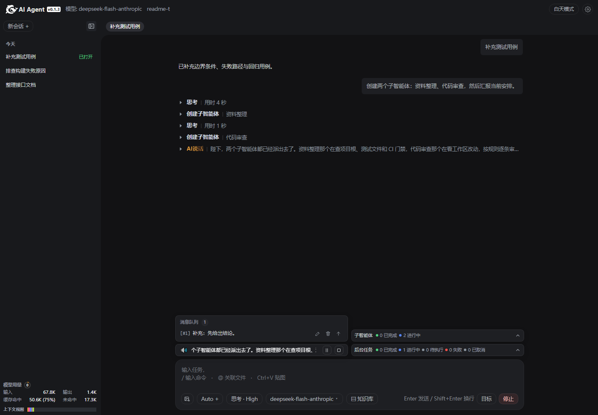

[English](README.md) | **中文**

# AI Agent

<p align="center">
  <strong>可扩展、可组合的 AI Agent 底座</strong>
  <br>
  支持本地运行与服务化接入，过程可查，写盘可控。<br>
  从模型、工具、插件到业务接入，按需扩展与组合。
</p>

<p align="center">
  
  
  
</p>

## 下载

打开 [Releases](https://github.com/diky87688973/ai-agent/releases) 页面，选择版本，在 **Assets** 中下载。

### Windows

- `ai-agent-<version>-full-pack-windows.zip`
  首次使用，下载后解压，运行 `agent-gui.exe`。

- `ai-agent-<version>-update-pack-windows.zip`
  仅用于已安装版本的自动更新，不能单独运行。

### macOS

- `ai-agent-<version>-full-pack-macos.zip`
- `ai-agent-<version>-update-pack-macos.zip`

macOS 安装包暂未构建，当前 Release 只提供 Windows 包。

## 特点

- **本地优先，模型端点自选** —— 会话、文件、工具与写盘门控在本机执行；模型端点和推理档位按需配置。
- **四种入口，一套内核** —— 桌面 GUI、Web 界面、交互终端与无头执行共用会话、工具和门控规则，切换入口不改变行为。
- **可服务化接入** —— 内核不绑定 UI，Web 入口提供本地 HTTP/SSE 与健康检查，无头入口面向脚本、CI、工单和外部系统调用，插件可追加自己的 HTTP 端点。
- **访问鉴权** —— 浏览器登录，GUI 一次性免登录；scrypt 密码、HttpOnly 会话、CSRF、scope Token、登录限流、公网 TLS。
- **插件化扩展** —— 工具、执行器、上下文、提示词、门控、模型目录、HTTP 端点与界面资产均可由插件加入，不修改内核；内置 Skills、Rules、知识库、多模型、视觉操作与 AI 说话。
- **多智能体协作** —— 子智能体按批次创建，拥有独立会话与角色工具视图；支持父子双向通信、消息队列、工作汇报。
- **长任务可管理** —— 后台任务按会话隔离，支持并发上限、超时、取消与输出读取；目标、Todo 和消息队列支持多回合推进。
- **定时唤醒** —— 可注册相对或绝对时间的唤醒任务；宿主在回合结束后投递，目标空闲即启动，忙碌则排队。
- **写盘可审查** —— 预览 → 审查 → 提交 → 重读；改前自动备份，可按版本回滚；删除进入回收目录。
- **上下文可查、会话可恢复** —— 分段预算、超预算摘要、上下文用量与请求快照；事实流落盘，SSE 断线可按事件坐标续传。
- **安全更新** —— 更新包哈希校验、暂存、健康检查与失败回滚；普通文件覆盖，`*.ini` 合并用户配置。

## 快速开始

### 桌面方式

保持项目目录完整，双击根目录 `agent-gui.exe`。

需要本机 Python 3.10+ 和系统 WebView2；首次运行会联网准备 pywebview。桌面壳使用固定端口 `3156`。



### 命令行方式

安装：

```bash
python3 -m pip install -e ".[gui,tts]" -c constraints.txt
```

#### Web 界面

```bash
agent-web --host 127.0.0.1 --port 8765
```

打开 <http://127.0.0.1:8765/>。Windows 也可双击 `start.bat`，Linux/macOS 可运行 `./start.sh`。

#### 交互终端

```bash
agent-cli
agent-cli --session <会话ID>
```

#### 无头执行

```bash
agent-headless "问题"
agent-headless --session <会话ID> "问题"
```

输出事件流与会话 ID；适合工单、排障、CI 和脚本集成。

#### 桌面窗口

```bash
python3 -m agent.gui.launcher
```

端口 `3156`；与 `agent-web` 的 `8765` 相互独立。

## 文档

### 用户文档

| 文档 | 内容 |
|---|---|
| [配置](docs/guide/config.zh.md) | 配置项、启动参数与环境变量 |
| [桌面入口](docs/guide/desktop.zh.md) | `agent-gui.exe`、Python 桌面壳与运行前提 |

### 开发者文档

| 文档 | 内容 |
|---|---|
| [架构](docs/architecture.zh.md) | 五层结构、模块链、端口、事件协议、状态生命周期 |
| [工程标准](docs/engineering-standards.zh.md) | 模块结构、单一职责、资产归属、扩展路径与门禁 |
| [术语](docs/glossary.zh.md) | 项目自定义词的定义 |
| [内核](docs/subsystems/core.zh.md) | 模块契约、链执行器、宿主循环 |
| [上下文管理](docs/subsystems/context.zh.md) | 三拼接装、分段统计、压缩与摘要 |
| [模型调用](docs/subsystems/llm.zh.md) | 请求体、流式解析、工具调用归并、错误映射 |
| [工具](docs/subsystems/tools.zh.md) | 注册、执行管道、写盘四步协议、内置工具 |
| [插件](docs/subsystems/plugins.zh.md) | 插件包形态、可贡献的能力、界面资产、生命周期与边界 |
| [知识库](docs/subsystems/knowledge.zh.md) | `knowledge` 的文件收录、勾选状态、注入与端点 |
| [多模型](docs/subsystems/multi-model.zh.md) | `multi_model` 的目录条目、设置页表单与模型下拉 |
| [Skills](docs/subsystems/skills.zh.md) | `skills` 插件的三层披露、内置/外置来源与 `skills` 工具 |
| [Rules](docs/subsystems/rules.zh.md) | `rules` 插件：`rules/` 下的 `.md` 全量注入与热开关 |
| [视觉操作](docs/subsystems/visual-operator.zh.md) | 截屏、坐标网格与鼠标键盘工具 |
| [AI说话](docs/subsystems/ai-speak.zh.md) | `ai_speak` 的文本规范、语音合成、插件事件与播放器 |
| [会话与协作](docs/subsystems/session.zh.md) | 事实日志、跨进程锁、运行态登记、协作网格 |
| [子智能体](docs/subsystems/subagent.zh.md) | 父子会话、批次、工具可见性、消息与最终回复投递 |
| [壳层](docs/subsystems/shell.zh.md) | HTTP 路由、SSE、界面打包、适配层 |

### 设计文档（内部）

以下为设计记录与取舍，不是用户手册。

<details>
<summary>展开设计文档</summary>

| 文档 | 内容 |
|---|---|
| [后台任务](docs/plan/background-tasks.zh.md) | per-cid 队列、并发上限、超时、取消、输出与聚合通知 |
| [软件更新](docs/plan/software-update.zh.md) | 版本检查、哈希校验、逐文件切换、备份与回滚 |
| [会话消息队列](docs/plan/conversation-queue.zh.md) | 忙时入队、回合结束投递、安全插入与修改恢复 |
| [标准对齐](docs/plan/standards-alignment.zh.md) | 依赖环、门禁可信度、覆盖率口径与预算 |
| [结构整改](docs/plan/structural-remediation.zh.md) | Provider、上下文、壳层与门禁的职责拆分 |
| [历史分页](docs/plan/history-paging.zh.md) | 轮次分页、游标、前插与超长报文延迟渲染 |
| [多模型](docs/plan/multi-model.zh.md) | 模型目录、Provider 路由与协议适配 |
| [AI说话](docs/plan/ai-speak.zh.md) | 文本切片、SSE 与播放器设计 |
| [视觉操作交互](docs/plan/visual-operator-interaction.zh.md) | 截屏、UIA 与坐标控制的设计判断 |
| [视觉操作](docs/plan/visual-operator.zh.md) | 视觉操作子系统的设计记录 |
| [ADR：插件子进程隔离](docs/adr/plugin-subprocess-isolation.zh.md) | 隔离方案的决策记录 |

</details>

## 开发帮助

### 环境

依赖安装带锁文件，与 CI 同源：

```bash
pip install -e . -c constraints.txt
```

### CI

`scripts/ci.py` 的流水线 30 步：18 项门禁 → 单测 → 10 个验收脚本 → 分包覆盖率。

18 项门禁覆盖依赖方向、架构约束、配置漂移、生成文档一致性、静态检查、UI/文案、复杂度、适用性与并发争用；完整清单用 `--list` 查看。

门禁清单的唯一事实源是 `scripts/ci_steps.py`，由 `check_ci_workflow` 与 GitHub Actions 对齐。

```bash
python scripts/ci.py           # 全部检查
python scripts/ci.py --fast    # 跳过验收
python scripts/ci.py --list    # 列出检查项
```

### 测试

`docs/unit-tests.md` 是生成的可读测试目录，事实源是 `tests/`。

单元测试（1985 个用例）：

```bash
python -m unittest discover -s tests -p "test_*.py" -t tests
```

### 调试工具

导出某个会话的真实请求上下文：

```bash
python scripts/dump_context.py --cid <会话ID> --format json --out context.json
```

检视会话的上下文分段与压缩判定：

```bash
python scripts/inspect_compact.py                 # 列出有日志的会话
python scripts/inspect_compact.py <会话 id>        # 检视其中一个
python scripts/inspect_compact.py <会话 id> --digest
```

审计本地 JS 事件绑定：

```bash
python scripts/scan_js_events.py
```

## 作者

- 作者：Fan
- 邮箱：diky87@qq.com

## 许可

[MIT License](LICENSE)。第三方组件署名见 [NOTICE](NOTICE)。
