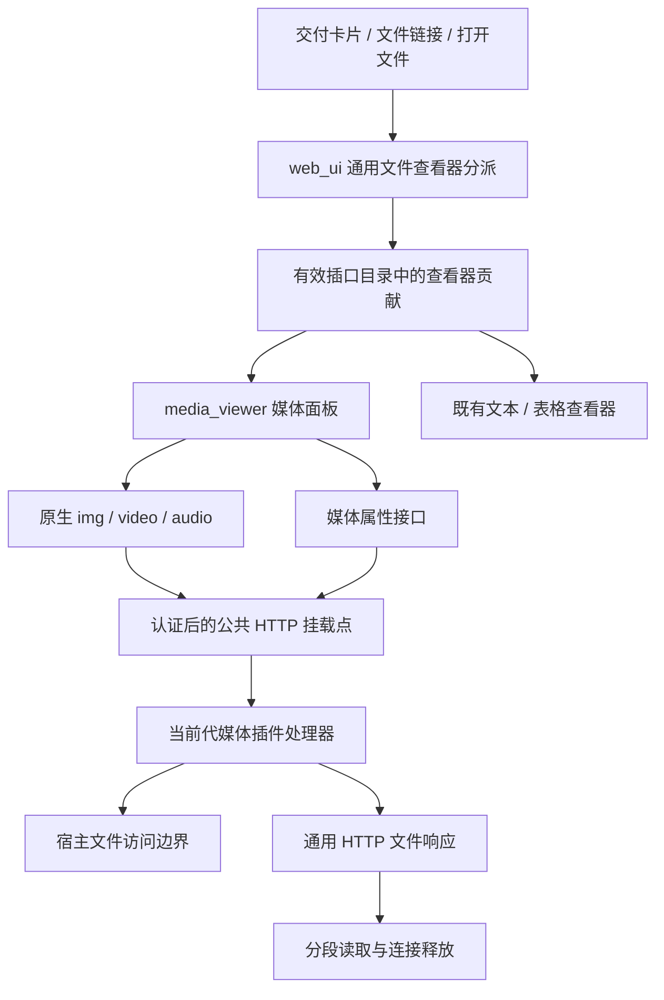

# 媒体预览插件设计

状态：实现已落地，工程验证结果见文末。本文定义媒体预览及其通用扩展契约，原生桌面实测范围为 Windows WebView2。

插件目录名采用 `media_viewer`，设置页名称为「媒体预览」，右侧文件标签显示文件名。使用原生 ``、`<video>`、`<audio>` 展示本地媒体，播放控件由浏览器提供。先完善通用扩展契约，再开发插件；本专项不调整模型调用、会话事实、消息队列或上下文。

## 1. 需求与边界

### 1.1 交付目标

- 从现有交付卡片的「预览」、本地文件链接、右侧打开文件入口进入同一套文件预览分派。
- 图片、视频和音频由媒体插件处理，文本与表格继续使用原有查看器。
- 右侧各文件标签分别显示对应文件、原生媒体控件和属性。播放类文件支持播放、暂停、拖动进度及原生音量控制。
- 保留 `/api/media?path=...` 公共地址，由插件提供实际媒体实现；现有正文图片引用继续可用。
- 大文件按块传输，支持 HTTP Range，不把整个媒体文件载入 Python 内存或先转换成前端 Blob。
- 插件声明、媒体识别、面板内容、样式和错误交互归插件包；关闭面板和插件卸载必须释放媒体资源。

### 1.2 本次不包含

不增加模型工具、不挂起模型回合、不要求二次确认；用户打开文件不向模型发送消息。不开发转码、下载器、播放列表、字幕编辑、音频波形、网络视频抓取或外部播放器。浏览器不支持的编码明确提示，不临时启动 FFmpeg 或安装解码包。

仅支持授权目录内的本地普通文件。HTTP/HTTPS 外链、直播、设备、管道与任意 URL 代理不在本次范围内。媒体预览不写文件、不改源文件、不生成缩略图缓存、不读取会话 `.raw`。

## 2. 实施前代码基线与缺口

实施前核对基线为提交 `6d7f8bb`；下表记录改造前的缺口。当前实现已经迁移媒体入口并提供通用响应与查看器契约，维护时应重新读取实际源码。

| 当前事实 | 代码位置 | 对方案的影响 |
|---|---|---|
| 右侧面板按 `data-pane` 动态创建，已有插件挂载点 | `plugins/web_ui/plugin-slots.json`、`ui/classic/js/panels/panes.js` | 复用面板容器，不另建右侧栏 |
| `openFileTab()` 固定使用 `renderFilePane()`，二进制只显示提示 | `plugins/web_ui/ui/classic/js/panels/file-viewer.js` | 缺少可由插件声明的文件查看器分派 |
| `/api/media` 由宿主分支调用 `media()`，后者 `read_bytes()` 整文件读取 | `agent/shell/web/web_routes.py`、`web_files.py` | 必须迁移具体实现并移除整文件读取路径 |
| `/workspace/` 也调用同一个 `media()` | `agent/shell/web/web_routes.py` | 迁移前审计调用者，不能只删函数导致工作区引用失效 |
| `kind=http-route` 已被声明解析器接受，但绑定器没有对应分派 | `agent/core/slot_spec.py`、`agent/capabilities/slot_binder.py` | 不能把「类型存在」当作「插件公共路由可用」 |
| 普通插件 `route` 固定挂到 `/api/plugin/<插件>/...`，响应以 JSON/文本为主 | `agent/capabilities/contributions.py`、`agent/shell/web/web_plugin.py` | 不能简单把绝对 URL 填进现有相对路由，也不能用字符串返回二进制 |
| `_slot_http()` 固定写 JSON，当前方法集合没有 HEAD | `agent/shell/web/web_routes.py`、`agent/core/slot_spec.py` | 需要通用文件响应和 HEAD 契约 |
| 插件 HTTP 请求通过租约保护，活跃读取结束后发布新代 | `agent/shell/web/web_plugin.py`、`agent/core/slot_lifecycle.py` | 媒体传输必须纳入同一生命周期，不额外建立热插拔旁路 |

## 3. 架构与资产归属



| 资产 | 权威归属 | 约束 |
|---|---|---|
| HTTP 请求/响应数据契约 | `agent/common/` | 只含通用数据和端口，不含媒体、插件名或壳层实例 |
| HTTP 挂载、认证、文件响应写出、Range、HEAD | `agent/shell/web/` | 通用传输能力，不识别具体插件名 |
| 可读根、路径解析和文件打开权限 | 现有宿主文件访问边界 | 复用 `media_root`、`fs_roots` 的既有语义，不复制配置或扩大权限 |
| 声明解析、绑定、有效视图、撤销 | 既有 SlotAssembly、SlotBinder、SlotRegistry | 同一棵树；路由和 UI 索引仅为有效声明的投影 |
| 文件查看器分派、右栏容器生命周期 | `plugins/web_ui/` | 通用入口和容器；不包含媒体识别表、播放器 HTML 或媒体样式 |
| 媒体类型识别、接口处理、播放器和属性 UI | `plugins/media_viewer/` | 全部在包内，通过声明接入 |
| 测试 | `tests/` 及既有验收目录 | 使用临时数据和自建媒体样本，不使用真实会话或用户文件 |

通用基座完善会修改包外公共代码，因为当前确有契约缺口。这一步独立交付并通过假插件验证；基座完成后，媒体功能的实现应落在 `plugins/media_viewer/`，不能继续给宿主追加专用分支。测试、文档和启用清单不算插件实现资产。

## 4. 插件 2.0 接入设计

### 4.1 公共 HTTP 挂载点

采用「宿主声明公共地址的契约，插件贡献实现」的方式。公共 URL 不等于宿主业务实现，插件也不通过覆盖整个宿主服务来取得 URL。

静态片段声明 `app/shell/http/mounts` 容器及以下可填充挂载点。每个挂载点是接受子贡献的容器，`props` 声明公共路径及允许的方法；自身不含媒体处理函数。

| 挂载点 | 公共地址 | 允许方法 |
|---|---|---|
| `app/shell/http/mounts/media-content` | `/api/media` | GET、HEAD |
| `app/shell/http/mounts/media-info` | `/api/media/info` | GET |

插件通过 `provides` 在挂载点下贡献 `http-route` 子节点，使用自身 `plugin:make_*` 工厂，`method` 指定处理的方法。子节点的公共路径从父挂载点派生，不另写第二份 URL。处理器无插件级可变运行态，不制造空的 runtime 节点；每个请求独立拥有文件资源。

约束：

1. 先收齐挂载点和贡献，再校验；不依赖目录扫描顺序。
2. 每个挂载点、每个方法至多一个有效处理器。重复贡献拒绝候选代，不按最后加载者静默覆盖。
3. 挂载点允许的方法是授权边界；子贡献越界即失败。HEAD 同步加入声明层方法校验及负向测试。
4. 公共地址由宿主挂载契约授权，插件不能借此接管登录、认证、插件资产或任意内置 URL。
5. `origin` 保持贡献插件身份，挂载点的 `owner` 沿现有授权规则派生；不能把宿主 owner 当作插件实现来源。卸载按 origin 撤销贡献。
6. 请求按当前有效视图解析处理器；可重建的路由索引不得拥有独立可写配置。
7. 热插拔只增删或替换插件子贡献，公共挂载点的静态契约保持不变，不触发宿主在线迁移。
8. 非冻结实现可按统一覆盖规则替换；冻结、冲突、回滚和生命周期仍使用现有机制。

公共挂载由 `build_http_mounts` 从当前租约快照派生，壳层只缓存该快照对应的只读投影，不提供独立登记入口。既有 `HttpRouteSlots` 的宿主 JSON 路由保持原契约；新挂载使用明确的请求/响应类型，不通过旧元组或异常猜测来传输文件。

未启用插件时，公共媒体挂载点返回 `503 handler_unavailable`。挂载点不允许的方法返回 `405` 和准确的 `Allow`；不回落到旧的 `read_bytes()` 实现。已有 `/api/plugin/<插件>/...` 相对路由保持原命名空间规则。

### 4.2 文件查看器插口

在 `web_ui` 根的固定子级中增加通用 `file-viewers` 挂载点：

```text
app/shell/web-ui/file-viewers                 web_ui 拥有，children=keyed
  /media                                     media_viewer 的 provides 贡献
```

查看器声明包含版本、支持的扩展名/MIME 提示、脚本、样式及排序。扩展名集合由对应插件声明，不在打开入口再抄一份；不新增一个与有效插口目录并行的查看器配置表。

扩展名用于无文件内容读取的快速分派，实际访问和最终类型由后端验证。未命中插件的目标由 web_ui 既有默认查看器处理文本或表格；无后缀二进制不承诺自动识别，不进行全文件嗅探。查看器目录尚未就绪时显示准备状态，就绪后自动分派；用户已关闭的准备面板不会再次打开。

查看器竞争先使用有效视图解决显式覆盖，再按声明顺序选择匹配项；同等优先级的冲突应在构造或目录校验时给出明确错误，不能随机选中。没有命中的查看器不代表文件为空。

`classicComponents` 的声明校验与脚本归属检查支持查看器子节点契约。插件不能通过覆盖全局 `openFileTab`、猴子补丁、捕获全页面点击或扫描 DOM 文字抢入口。

### 4.3 前端查看器契约 v1

| 方法 | 语义 |
|---|---|
| `open(context)` | 打开或替换当前目标，返回可释放的查看器实例 |
| `activate()` | 面板显示；不自动恢复播放 |
| `deactivate()` | 面板隐藏或会话切换；暂停播放 |
| `dispose(reason)` | 幂等取消请求、移除源、释放监听器和对象 |
| `canReuse()`（可选） | 同路径再次打开时是否复用当前实例；媒体错误态返回 false，用户重开可重试 |

`context` 包含版本、原始目标路径、打开来源、面板 ID、挂载元素、AbortSignal 和通用大小格式化函数。实例只拥有自己的容器，不直接操作其他插件或聊天正文。

通用面板增加激活、隐藏、关闭和替换的生命周期通知；现有 `ai-agent:panel-opened` 保留。不能只发送「打开」而让插件用 MutationObserver 猜关闭。新实例完成挂载前若已被取消，不得再次填充旧容器。

## 5. HTTP 与文件传输契约

### 5.1 请求上下文 v1

新公共挂载处理器接收只读请求描述：`version`、`method`、`path`、查询参数、标准化请求头和宿主提供的只读文件访问端口。集合必须真正只读；不把 `BaseHTTPRequestHandler`、socket、`WebShell` 或整个 `App` 交给插件。

文件访问端口按既有媒体可读根解析并打开普通文件，提供文件句柄与该句柄的 `fstat` 属性。权限规则仍由宿主持有，插件不能自行指定更宽的根目录。媒体插件负责判断该普通文件是否属于支持的媒体类型。

处理器返回 `JsonResponse` 或 `FileResponse` 等显式类型。数据契约位于 `agent/common/http_contract.py`，传输实现位于 `agent/shell/web/http_responses.py`；两者不依赖具体插件。当前公共挂载契约只提供只读 GET/HEAD，不开放任意写端点；既有相对插件路由仍按原协议提供业务动作。

`FileResponse` 提供已打开的二进制源、该文件的属性与 MIME，安全响应头及范围处理由通用写出者负责。句柄单次转交响应写出者，不复制或共享读取位置。构造失败时由构造者关闭，交接后由写出者在成功、HEAD、异常和断开时统一关闭；不允许两方都认为对方负责。

### 5.2 内容接口

```text
GET  /api/media?path=<URL 编码的本地路径>
HEAD /api/media?path=<URL 编码的本地路径>
GET  /api/media/info?path=<URL 编码的本地路径>
```

路径只解码一次，不接受 `file://`、设备路径或远程 URL。相对路径沿现有工作区规则解析；绝对路径仍必须通过授权根校验。媒体读取不以会话 ID 代替文件权限，前端关联会话仅用于视图生命周期。

Range、条件请求和文件写出是通用 HTTP 能力：

| 请求情况 | 响应行为 |
|---|---|
| 无 Range 的 GET | `200`，按块写完整响应，不整文件读入内存 |
| 有效单范围 `bytes=start-end` | `206`，准确的 `Content-Range`、`Content-Length` |
| 开放尾部 `bytes=start-`、后缀 `bytes=-length` | 正确换算范围并裁剪到文件边界 |
| 语法错误、起点越界、反向范围、空文件上的有效字节范围 | `416`，`Content-Range: bytes */<size>`，错误体长度准确 |
| 多范围 | 首版不实现 multipart；忽略 Range 并按标准返回完整 `200`，不能伪造单范围 `206` |
| 未知范围单位 | 忽略 Range 并返回完整 `200`，不把未知单位当字节范围 |
| HEAD | 返回与普通 GET 对应的资源头，不写响应体，不应用 GET 专用 Range |
| If-Range 不匹配或无法用于强校验 | 忽略 Range，返回完整 `200` |
| 客户端断开 | 立即结束传输并释放句柄和租约，不继续读剩余文件 |

正常响应包含正确 MIME、`Content-Length`、`Accept-Ranges: bytes`、`Last-Modified`、`X-Content-Type-Options: nosniff` 和安全编码的文件名。响应默认要求重新验证缓存，不建立插件磁盘缓存。

首版不生成内容哈希或 ETag，也不把大小与修改时间伪装成强校验器。文件系统修改日期无法证明文件在同一秒内未多次改变，因此带 If-Range 的请求返回完整 200；普通 Range 仍返回 206。Last-Modified 支持 If-Modified-Since 再验证，但不冒充 If-Range 强校验器。条件请求按 RFC 9110 区分语义，测试覆盖相同日期、旧日期、未来日期和弱标签。

读缓冲以 256 KiB 为初始实现目标，内存占用与文件体积无关。限制恶意超长 Range 头的解析量，不创建按文件大小分配的数组。阻塞写出需要有界的 socket 写超时，初始目标 10 秒无写入进展即结束；不设置「视频最多播放 10 秒」这种总播放限制。响应头发出后发生 I/O 错误只能关闭传输并留痕，不能再向媒体流中拼 JSON 错误体。

### 5.3 路径与文件一致性

根目录校验必须解析真实路径，拒绝越界符号链接、目录、设备与非普通文件。需校验打开后的对象与授权解析结果一致，避免「检查路径后文件被换掉」的竞态；不能只对字符串做前缀判断。现有文件边界若不足，应在通用访问端口修复，不在插件中另写不完整的权限实现。

每个 HTTP 请求使用独立句柄和 `fstat`，不能在并发用户间共享文件游标。读取期间若源文件缩短或读取失败，结束当前响应并报错；新请求重新核对属性。属性和媒体源的更新竞态必须测试，不承诺把修改中的文件变成不可变快照，也不为此复制整份媒体文件。

### 5.4 元信息接口

接口只做受限访问、属性查询和类型识别，不读完整文件，不启动子进程。示例为拟定 v1 形状：

```json
{
  "version": 1,
  "name": "演示视频.mp4",
  "path": "<经授权解析的完整路径>",
  "kind": "video",
  "mime": "video/mp4",
  "size_bytes": 103809024,
  "modified_at": "<带时区的时间>"
}
```

完整文件名来自后端属性，不从标题截断内容反推。前端使用 `textContent` 展示名字与路径，不能拼入 HTML。文件时间仅作属性与变化提示，不是内容完整性证明。

图片尺寸使用解码成功后的 `naturalWidth/naturalHeight`；视频尺寸与时长使用 `loadedmetadata` 后的 `videoWidth/videoHeight/duration`；音频显示时长，像素尺寸显示「不适用」。尚未取得的字段显示「读取中」，解码失败显示「不可获取」，不伪造零值。原生解码器提供的可用字段优先，不为元信息引入 FFprobe 依赖。

## 6. 媒体插件内部设计

当前包布局如下，媒体处理器为无状态闭包，通过标准库 MIME 类别识别图片、音频和视频，排除 SVG，不依赖 Web UI 的查看器节点：

```text
plugins/media_viewer/
  plugin-meta.json          身份与展示信息
  plugin-ui.json            UI 路径索引，实际 UI 声明仍由插口树提供
  plugin-slots.json         公共挂载贡献、查看器与面板贡献、唯一后缀提示表
  plugin.py                 声明工厂、媒体识别、内容和属性处理器
  ui/viewer.js              原生控件、元信息、生命周期
  ui/viewer.css             插件自有样式，全部使用专用前缀
```

前端扩展名选择清单只维护在插件声明中，用于选择查看器；后端按标准库 MIME 类别限定媒体响应，不复制该后缀清单。关闭 Web UI 后，媒体 HTTP 接口仍可独立使用；关闭媒体插件后，公共地址返回实现不可用。插件业务选项首版不新增配置文件，公共传输预算由通用传输能力拥有。

图片首版覆盖浏览器可解码的 JPEG、PNG、GIF、WebP、BMP、AVIF；视频和音频覆盖常见本地文件类型的识别与原生解码尝试。类型匹配不等于编码受支持：同为 MP4 的不同编码可能得到不同解码结果。

SVG、HTML、XML 和脚本类文件不能作为可执行内容通过媒体接口送出。SVG 不在首版图片预览承诺内，沿安全的不可预览/文本处理路径；支持 SVG 需另行设计净化与隔离。不能为了图片支持移除现有 SVG 防执行处理。

## 7. 面板布局与交互

### 7.1 布局

每个完整文件路径对应一个可关闭标签，标签显示文件名。同一路径重复打开时激活已有实例并保留播放位置；不同文件（包括不同目录中的同名文件）各自拥有标签、请求与原生控件。路径身份使用完整路径编码，不按媒体类别共用，也不使用有碰撞风险的短路径哈希。切换标签只暂停隐藏实例；关闭只释放该文件，插件卸载释放全部所属实例。不再贡献固定的「媒体」空标签；文件入口复用现有「打开文件」操作。

```text
右侧标签栏： [演示视频.mp4 ×] [演示音频.wav ×] [图片.png ×]

┌──────────────────────────┐
│ 媒体显示区                │
│ 图片 / 原生视频 / 原生音频  │
│ 视频和音频使用 controls    │
└──────────────────────────┘

完整文件名  演示视频.mp4
类型        视频 · MP4
尺寸        3840 × 2160 px
大小        99 MB
时长        1 分 2 秒
```

播放器显示在上方，其下依次展示完整文件名、完整路径和两列属性。文件名与路径直接常显，允许换行，不折叠、不省略路径中间部分。不添加与原生控件重复的播放工具栏，不显示 JSON、调试数据、装饰性属性卡片或多余分隔线。

图片和视频保持宽高比，宽度不超过面板，限制显示高度为可用面板高度的一部分；超宽、竖屏和大图均使用 contain 规则。音频条使用面板可用宽度，不放一个假视频画布。元信息用紧凑双列布局，窄面板改为标签和值上下排列。

配色遵循现有主题变量；文件名 16px、属性值 14px、标签与路径 12px，常规内容边距 20px、窄窗口 16px。明暗、极简和玻璃模式尺寸一致；右侧媒体内容保持主题要求的不透明底色，不自行引入磨砂、厚阴影或高饱和底块。视频黑边由媒体画面区拥有，不扩散到整块面板。

右侧通用标签栏自动换行，长标题只缩略标签文字，关闭按钮保持固定宽度。多行超过 `min(30vh, 240px)` 时使用可见的纵向滚动条，激活标签自动进入可见范围；不通过隐藏横向滚动条掩盖溢出。左右标签栏的尺寸变化均触发内容起点重算。

### 7.2 原生控件与状态

- `<video controls playsinline preload="metadata">`、`<audio controls preload="metadata">`；不设置 autoplay。`preload` 是浏览器提示，不能当作只请求少量字节的强保证。
- 图片使用 ``，设置可读 alt，加载成功后更新像素尺寸。
- 保留原生控件的键盘操作与焦点可见性，不全局取消 outline 或拦截滚轮。
- 普通面板区域滚动遵循原生滚动链，不把滚轮统一解释为缩放、音量或进度变化。
- 切到其他右侧标签或其他会话时暂停；回来不自动播放。此策略只约束媒体插件，不修改 `ai_cosplay` 的独立语音播放器。
- 原生控件的外观由 WebView/浏览器决定，允许平台差异，不承诺把不同平台的原生进度条画成完全一致。

查看器状态为 `empty → loading → ready / error → disposed`。播放/暂停/缓冲状态直接读取 HTMLMediaElement，不再复制一套独立播放状态机。每个路径实例只写入自己的容器。A 的请求即使晚于 B 返回，也不会覆盖 B；已关闭实例通过 AbortSignal 拒绝晚到响应。

### 7.3 错误展示

| 情况 | 用户可见行为 |
|---|---|
| 文件不存在或被移动 | 「文件不存在或已移动」，允许重新打开路径 |
| 超出授权目录 | 「该文件不在允许预览的目录内」，不自动扩权 |
| 插件未启用或已卸载 | 「媒体预览插件不可用」 |
| 浏览器不能解码 | 「当前浏览器无法播放此编码」，保留文件属性 |
| 文件损坏 | 明确加载/解码失败，不伪装为不支持所有同类文件 |
| 认证失效 | 使用通用登录/失效提示，不循环重试或另发匿名请求 |
| 传输中断 | 显示重试入口；只有用户重试才重新建立资源 |

首版不做无限自动重试，不把完整文件转 Base64 作为失败兜底。播放器失败不能影响会话发送或其他文件面板。

## 8. 生命周期与热插拔

### 8.1 前端释放顺序

`dispose()` 幂等执行：取消属性请求，暂停播放，移除 `src` 和 `<source>`，对音视频调用 `load()` 中止旧资源加载，清理监听器和观察器，销毁 DOM。图片清除源和监听器。若未来引入 Object URL，由创建实例负责 revoke；首版直接使用认证后的同源 URL，不创建整文件 Blob。

查看器注册的 disposer、当前实例和待加载脚本必须在插件代变更后失效；旧脚本加载完成不能重新注册已卸载的查看器。脚本归属、面板 ID、实例代号分别承担来源校验、容器身份和异步取消，不能混用。

### 8.2 后端租约

公共插件路由与既有插件路由使用同一生命周期保护：解析有效处理器、调用插件、写出文件响应和最终关闭资源均处于该请求租约内。不能在返回 `FileResponse` 时提前释放租约，让旧插件在传输期间被卸载。

热插拔请求在存在活跃读取者时按现有规则排队，状态必须可查询。播放器处于暂停并不保证网络连接已经结束；关闭媒体标签或卸载前释放 `src` 才能主动断开。长时间在途的普通下载也可能延迟代发布，不能声称「点击卸载立即完成」。

设置页发起插件停用/重载时，应通过通用的插件 UI 预释放通知，让当前浏览器的对应查看器停止传输；通知不冒充新代已经发布，也不替代后端租约。其他客户端仍以在途请求结束或断开为准，状态显示「等待在途请求结束」。此通知属于通用 UI 生命周期，不能点名媒体插件。

本次不更改全局租约排队与公平性算法，不强杀合法下载、不在 runtime 的 dispose 中等待自己的 HTTP 租约。未来若要求强制立即卸载，应单独设计通用传输取消协议，不能在本插件中偷偷截断所有 HTTP 连接。

### 8.3 持久化

媒体面板选择和播放位置首版仅存实例内存；页面刷新或程序重启回到空态，不自动请求旧文件，不自动播放。文件路径不进入会话事实、模型上下文或新的 SQLite 表。以后需要恢复播放位置时再定义独立的视图状态格式。

## 9. 现有行为迁移与影响面

| 现有行为 | 迁移要求 |
|---|---|
| 交付卡片「预览」 | 调用统一文件打开分派，媒体进入以文件名命名的独立标签；交付卡片仍在交付区，不改变折叠规则 |
| 文件链接、路径点击、手动打开文件 | 复用同一分派；文本和表格展示保持原行为 |
| 正文图片 `/api/media` | URL 保持不变，走插件内容实现，回归相对/绝对路径和跨盘授权根 |
| 现有图片灯箱 | 保留原有打开、关闭和缩放交互；可以复用媒体 URL，不能强制把所有图片点击改成右栏 |
| `/workspace/` 引用 | 审计现有文本与二进制调用；复用通用文件响应，媒体经有效实现处理，文本保持安全 MIME；不得留下整文件读取旁路 |
| SVG 与主动内容 | 保留现有不执行策略，不因通用流响应自动变成可执行响应 |
| `ai_cosplay` 音频 | 保持自身队列、合成与播放逻辑；不接管、不复用其状态或声音资源 |
| 认证与 Token scope | 公共媒体 GET/HEAD 使用既有 read 权限；不放到 admin 专用插件接口中，也不改成公开免认证 |
| CLI / headless | 不加载面板，不增加交互等待，不改变工具结果 |

迁移完成后删除宿主中的媒体业务实现和无调用者的旧方法。必须先枚举并迁移调用者；禁止为旧私有方法留转发别名，禁止把旧整文件读取作为插件关闭后的兜底。

## 10. 并发、可观测性与预算

每个请求独立拥有句柄、缓冲区与租约；不得以全局锁覆盖整个媒体传输。通用文件传输层提供每个 WebShell 16 路同时传输的非阻塞准入，最多约 4 MiB 显式读缓冲，满额返回 `503 Retry-After`。这限制文件响应，不改变整个 HTTP 服务的线程模型，也不承诺限制全部连接或所有解码内存。

实施时以当前服务线程模型确定准入值，并记录选择依据；不能凭设计文档预先宣称固定并发数满足所有机器。验收至少覆盖 8 路并发播放/Range 请求与普通聊天请求混合场景，确认媒体流不长期占住会话锁、插件变更锁或模型请求资源。

异常日志包含接口或传输阶段和错误信息，预期的权限/类型错误以结构化响应返回；不记录文件内容、音视频数据、Cookie 或 Token，不逐块打印正常传输日志。浏览器主动关闭连接不打错误堆栈；权限拒绝、文件异常和响应写失败可区分。

## 11. 测试与验收

### 11.1 通用契约测试

- 用不含媒体逻辑的假插件贡献公共文件响应和文件查看器，证明宿主不依赖 `media_viewer` 名字。
- 声明缺失、方法越界、HEAD 解析、同方法重复贡献、冻结覆盖、工厂失败和候选代回滚。
- 插件 HTTP 与 UI 的声明、构造、绑定、快照、查询及卸载路径一致；撤销后无路由或查看器残留。
- 旧 JSON 路由、相对插件路由、内置路由及鉴权行为保持原契约。

### 11.2 文件与 HTTP 测试

覆盖零字节、中文/空格/特殊符号文件名、多盘授权根、相对路径、路径越界、符号链接替换、目录和非普通文件。覆盖 Range 起止、后缀、开放尾部、空文件、越界、多范围、畸形/超长请求头、HEAD 无体、If-Range、缓存再验证和响应长度。

以会拒绝无界 `read()`/`read_bytes()` 的文件夹具证明分块读取；大文件测试使用临时稀疏文件或受控文件源，不生成数 GB 实体测试数据。验证内存不随文件体积线性增长，多个请求不共享游标，断开后不继续读尾部，异常路径句柄和租约均归零。

### 11.3 UI 与生命周期测试

覆盖图片成功/失败、视频和音频元信息、长文件名、未知编码、重复打开、快速 A→B 切换、隐藏暂停、关闭释放、插件停用/重载、晚到脚本/请求不复活旧实例。验证不会自动播放、不会给模型增加消息、不会阻塞发送、不会改变交付区或执行过程结构。

### 11.4 真实窗口截图与操作证据

使用隔离数据根与自行生成的小型测试媒体，不使用真实会话或修改工程 `data/`。截图来自桌面 WebView 窗口，每张附操作与结果说明。

| 场景 | 证据 |
|---|---|
| 图片 | 图片完整、自适应；文件名、类型、像素尺寸、大小正确 |
| 视频 | 播放/暂停、拖到中间与靠近结尾；图像、进度和属性正确 |
| 音频 | 播放/暂停、拖进度；原生音频条和时长正确 |
| 主题 | 白天、黑夜、极简、玻璃模式；尺寸不跳变，主体背景正确 |
| 面板尺寸 | 窄右栏、长文件名、横屏/竖屏媒体；控件不越界 |
| 错误与卸载 | 无权限、不能解码、关闭后无声音、卸载后无活跃媒体请求 |

截图证明界面，不替代分段读取和并发测试。Windows WebView2 必须实测；macOS/Linux 的通用 Web 页面行为依可用环境验证，原生桌面集成不属于本专项，未验证平台单独列出。

### 11.5 工程门禁

按仓库入口运行受影响测试、UI JS、依赖方向、架构、插口配置/有效视图/替换、静默异常、注释文案及文档一致性检查。新增用例后同步生成用例和复杂度文档，README 数字从实际结果更新；不改门禁阈值、不为增计数写镜像测试。实施完成进入提交准入时运行全量 CI，并保留通过、失败、跳过及未验证项。

## 12. 实施顺序与完成判据

| 阶段 | 工作 | 完成判据 |
|---|---|---|
| A 当前基线复核 | 重新核查协议、文件入口、媒体调用者、HEAD、认证、线程模型及主题 | 实际影响面清单明确，没有凭记忆选文件 |
| B 公共 HTTP 能力 | 挂载契约、http-route 绑定、请求/响应类型、文件访问端口、Range/HEAD 和资源关闭 | 假插件可提供受保护的流式文件响应；故障与负例通过 |
| C 公共查看器能力 | 声明分派、组件归属、面板 activate/deactivate/dispose、通用预释放通知 | 假查看器可独立加载、替换、卸载；文本/表格无回归 |
| D 媒体插件 | 包内声明、类型识别、内容/属性接口和原生面板 | 新插件的实际能力归包内，图片/视频/音频打通 |
| E 入口迁移 | 交付预览、文件打开、既有媒体引用与 workspace 调用者迁移 | 原有链接可用，无旧整文件媒体读取及转发残留 |
| F 回归与交付 | 并发、大文件、权限、取消、热插拔、主题和真实窗口证据 | 门禁与受影响回归通过，限制和未验证平台如实登记 |

每阶段先读当前源码，独立复核资产与失败路径，再继续后续阶段。A–C 的公共规则稳定前，不在媒体包中堆兼容层；D–F 完成前不把功能标记为已交付。

## 13. 设计取舍与待验证边界

| 取舍 | 原因与后果 |
|---|---|
| 原生控件 | 满足基础播放、暂停和进度操作，不引入播放器库；控件外观和解码能力随环境变化 |
| 先补通用基座 | 当前路由和文件查看器存在实际缺口；完成后后续查看器和文件服务不应再改内核 |
| 公共地址稳定，插件提供默认实现 | 保持已有 `/api/media` 引用，同时明确具体实现的插件归属 |
| 按完整路径复用标签、内存视图状态 | 每个文件资源独立；切换暂停，关闭释放；不承诺跨重启恢复或后台继续播放 |
| 请求完整持有租约 | 遵守现有热插拔语义；合法长下载可能延迟发布，不能同时承诺强制立即卸载 |
| 不转码、不扫全文件 | 避免额外进程、临时文件和大文件读取；不支持编码只能提示，不能保证任意媒体可播 |

本设计不需要新增业务决策即可进入实施。实施时若发现公共路由生命周期与现有租约无法一致、打开后路径授权无法可靠校验，或并发传输会阻塞聊天，应先停止相关实现并报告具体证据，不能用绕过鉴权、提前释放租约或整文件缓存换取表面可用。

## 14. 关联规范与技术依据

- [插件 2.0 插口协议](plugin-slots-protocol.md)：声明、归属、有效视图、覆盖和贡献规则。
- [插件热插拔实现与验证](plugin2-hotplug.md)：请求租约、候选代发布和失败回滚。
- [工程标准](../engineering-standards.zh.md)、[架构](../architecture.zh.md)、[质量门禁](../quality-gates.zh.md)：依赖、资产归属与准入。
- [HTTP 鉴权设计](http-auth.zh.md)：认证、read scope 和路由边界。
- [HTML 媒体标准](https://html.spec.whatwg.org/multipage/media.html)：原生控件、媒体元信息和生命周期。
- [HTTP Range 请求](https://developer.mozilla.org/en-US/docs/Web/HTTP/Guides/Range_requests)：部分响应、范围请求与媒体随机访问。
- [RFC 9110 条件范围请求](https://www.rfc-editor.org/rfc/rfc9110.html#section-13.1.5)：If-Range 的强校验要求。

## 15. 实施复核与验证记录（2026-11-25）

### 基线与范围

基线为 `main`、`6d7f8bb`，与上游领先/落后均为 0。本次工作尚未提交或推送；新增文件均为下列源码、测试和本文，没有把截图、媒体样本、测试数据或缓存放入源码工作区。未改版本号、依赖或发布配置。

复核依据为 `AGENTS.md`、`skills/production-standards.md`、`skills/audit-procedure.md`、`docs/applicability.md`、工程标准、架构、配置指南、质量门禁和插件 2.0 协议。范围为本专项及其直接调用者，不声称全项目重新审计或跨平台原生验收。

| 资产 | 实际归属与检查结果 |
|---|---|
| HTTP 请求/响应与文件访问抽象 | `agent/common/http_contract.py`；只含通用契约，没有具体插件依赖 |
| 公共挂载与查看器声明校验 | `agent/capabilities/http_mounts.py`、`file_viewer_contract.py` 及现有绑定器；从有效插口视图派生，没有第二份业务注册表 |
| 授权文件访问、分块响应、公共地址分派 | `agent/shell/web/file_access.py`、`http_responses.py`、`web_public.py`；认证、文件根和传输预算由壳层负责 |
| 文件查看器分派与面板生命周期 | `plugins/web_ui/`；提供通用组件族与激活、隐藏、关闭事件，不硬编码媒体插件名 |
| 媒体处理与展示 | `plugins/media_viewer/`；声明、MIME 识别、元信息、原生控件和样式均在包内 |
| 配置与旧入口 | 根插口与 `plugins.ini` 登记默认实现；删除宿主旧媒体整文件读取方法，`/workspace/` 复用受限文件响应 |
| 测试与生成物 | 4 个新回归文件、既有 Web 测试和验收夹具显式加载媒体插件；用例与复杂度文档由生成器更新 |

### 关键复核结论

- 元信息采用完整文件名、常显完整路径与两列事实排版。路径可选择复制、自动换行，不截断、不折叠；不添加卡片套卡片、粗分隔线或阴影。
- 媒体 HTTP 接口不依赖 Web UI 存在。关闭 Web UI 后仍可读取媒体，关闭媒体插件后稳定地址明确返回实现不可用。
- 单请求只读当前分段；8 GiB 受控文件源的 HEAD 不读文件体，小范围请求只读所需字节。8 路并发 Range 与健康检查有集成测试；这不构成整机高并发容量承诺。
- 授权失败、路径替换、非法范围、资源不足、客户端断连、解码失败、重开、晚到请求和热卸载均有相应终态。关闭和隐藏不自动播放，不向会话注入事实或新消息。
- 发现的两项回归已经修复：隔离 Web 验收未加载新默认实现；媒体 HTTP 工厂强依赖网页查看器导致 Web UI 无法独立关闭。保留原有越界拒绝、根内可读及 Web UI 关闭/恢复断言。

### 测试、证据与限制

专项自动测试 20 项通过；原生窗口中图片解码、视频/音频播放暂停及拖动、隐藏暂停、关闭释放、热卸载和重载通过。截图来自隔离 Windows WebView2 窗口的原生 CapturePreview 接口，包含应用自绘标题栏；不是浏览器标签页截图，也不冒充系统窗口边框截图。

证据保存在工程外 `C:\Users\Fan\Documents\Codex\artifacts\media-viewer-20261125-szmbpoq7`：白天、黑夜、极简、玻璃主题样式和窄栏截图，以及原生验证结果与日志。玻璃模式只验证媒体区域与既有主题样式的整合，没有重新验证桌面背景采集；macOS/Linux 原生窗口与 POSIX 文件访问分支未实机验证。真实模型、真实语音和发布安装不属于本次验证，未调用或发布。

隔离窗口及测试服务已关闭；系统 Temp 中本次自行生成的样本清理被自动审批策略拒绝，暂留临时目录，不属于源码或用户会话数据。

### 工程准入结果

下列结果已包含按完整路径独立标签的修正，并通过本轮全量复跑。

本次 Windows 实施范围结论为 **PASS**，没有未解决的 BLOCKER 或 MAJOR；未验证平台与环境见上文，不扩大本次结论。

- `python scripts/ci.py --keep-going`：37 步中 36 通过、0 失败、1 跳过；跳过为规则白名单内的 `acceptance_mvp3` 真实模型验收，需要显式开启并提供真实模型环境。
- 单元测试共 2727 项，0 失败、0 错误、3 项跳过；覆盖率采集重新执行同一用例集，非环回网络请求为 0。
- 11 个分包的语句覆盖率均达到现有下限；没有调整阈值或削弱测试断言。Web 验收、并发争用、热插拔验收、插口注桩、有效视图和全部静态门禁通过。
- 补充检查：`ruff check`、`git diff --check`、注释文案、README 和两份生成文档一致性均通过。文档与源码的资产归属、生命周期、权限和失败路径已经逐项复核。
- 完整流水线日志、Web 验收日志、专项测试日志和原生窗口验证结果保留在上述证据目录。工作尚未提交、推送或发布；正在使用的升级测试目录未被替换。

### 按文件路径独立标签的补充验证

修正资产位于 `plugins/web_ui/ui/classic/js/panels/file-viewers.js`：通用分派按完整路径编码建立标签，以文件名展示；媒体插件删除固定右栏标签贡献和无消费者的 `pane` 属性。没有改动内核、HTTP 处理器、会话或持久化格式。

新增回归覆盖不同目录的同名文件、同路径重开保留原生元素和进度、隐藏暂停、关闭单个文件、关闭后重开及插件卸载全部释放；既有晚到请求测试改为验证关闭的 A 不覆盖仍打开的 B。专项共 20 项通过。

真实 Windows WebView2 窗口验证四个路径同时保留「视频甲.mp4」「视频乙.mp4」「音频.wav」「图片.png」标签；同路径重复打开没有新增标签且保留播放位置，关闭 B 后 A 的源仍存在，重载插件后可重新打开四个文件，未捕获脚本异常为 0。结果、窗口截图及本轮全量 CI 日志保存于 `C:\Users\Fan\Documents\Codex\artifacts\media-viewer-tabs-20261125`。未为旧的单媒体标签添加兼容逻辑。本轮 37 步中 36 通过、0 失败、1 项真实模型验收按既有规则跳过，分包覆盖率全部达标。

### 标签栏自动换行的补充验证

本次局部调整归 `web_ui` 的 `side-tabs.css` 与 `panels/panes.js`：恢复换行、保留纵向溢出操作、固定关闭按钮宽度、激活标签滚入可见范围，并同时观察左右标签栏尺寸。没有新增配置、接口、插口或持久化状态。

Windows 原生窗口实测：8 个长标题在宽栏为 4 行、窄栏为 8 行，横向溢出均为 0；28 个标签时内容高 732px、可见高 240px，当前标签可见，28 个均可通过实际事件委托切换并关闭。内容区位于标签栏下方，明暗及极简模式截图和脚本异常检查通过，未捕获异常为 0。

本次运行受影响的 20 项测试、完整 Web 验收、UI JS、注释文案、生成文档一致性及差异空白检查，均通过；按日常局部 UI 改动范围未重复执行全量 CI，上一节全量结果属于独立标签修正的基线。截图和日志位于工程外 `C:\Users\Fan\Documents\Codex\artifacts\media-tabs-wrap-20261125`。未新增镜像 CSS 规则的单元测试；跨平台原生窗口仍未验证。
